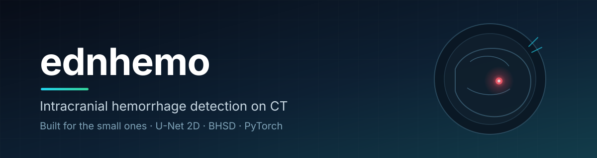
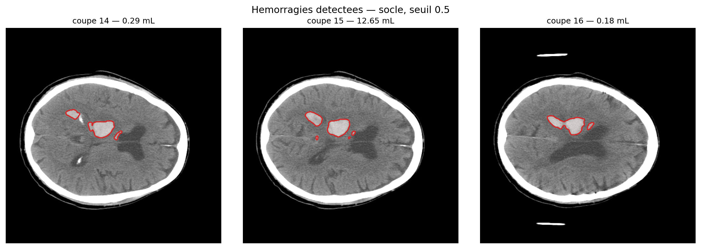
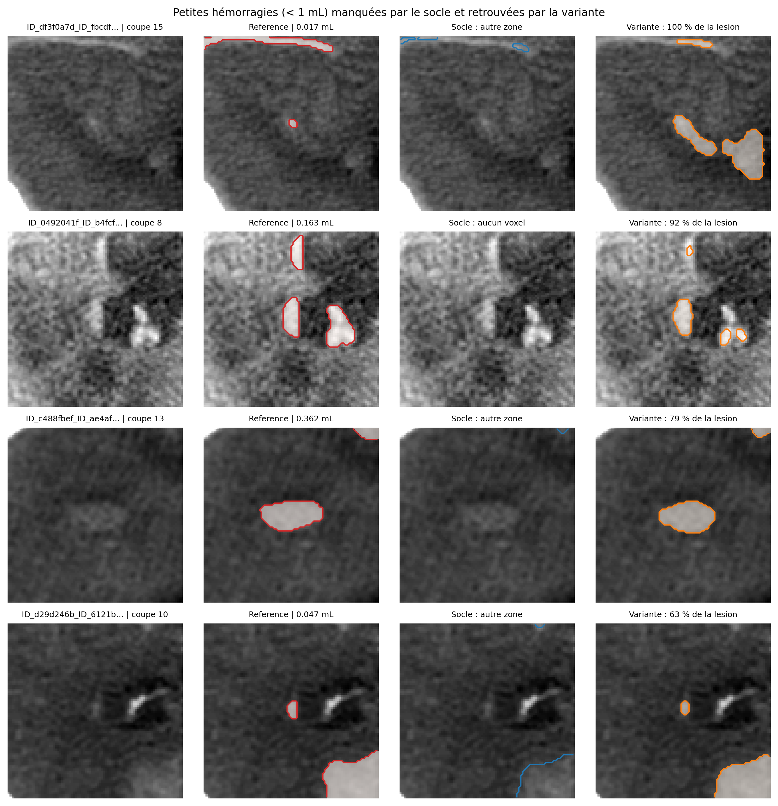
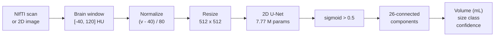

<div align="center">
  
</div>

<h3 align="center">Intracranial hemorrhage detection on CT — built for the small ones.</h3>

<p align="center">
  <a href="https://pypi.org/project/ednhemo/"></a>
  <a href="https://pypi.org/project/ednhemo/"></a>
  <a href="https://github.com/aimenachraff-jpg/ednhemo/actions/workflows/ci.yml"></a>
  <a href="https://github.com/aimenachraff-jpg/ednhemo/blob/main/LICENSE"></a>
  
  
</p>

<p align="center">
  <a href="#install">Install</a> ·
  <a href="#quickstart">Quickstart</a> ·
  <a href="#python-api">API</a> ·
  <a href="#models">Models</a> ·
  <a href="#results">Results</a> ·
  <a href="#how-it-works">How it works</a> ·
  <a href="#limitations">Limitations</a> ·
  <a href="#reproducibility">Research</a>
</p>

---

**ednhemo** segments intracranial hemorrhages (ICH) on non-contrast head CT and reports them **lesion by lesion**: volume in mL, size class, slice, and model confidence. It ships two trained 2D U-Nets inside the wheel — `pip install ednhemo` works offline, no checkpoint download, no Kaggle account.

It was built for a problem that pixel-wise Dice hides: **small hemorrhages**. A 30-voxel bleed can disappear completely while the Dice score barely moves. So the second checkpoint (`variante`) guarantees that **4 of every 8 training slices contain a hemorrhage under 5 mL**. On the official 96-scan test set it recovers **19 more lesions** than the reference model, **52 of the 58 recovered lesions are under 1 mL**.

<p align="center">
  
  <br>
  <em>One test scan → 5 hemorrhages (0.02, 0.04, 0.18, 0.29 and 12.6 mL), 4 of them under 5 mL.</em>
</p>

> [!WARNING]
> **Research prototype — not a medical device.** It is not validated for clinical use, has not been reviewed by any regulatory body, and must never replace a radiologist. Do not use it to make patient-care decisions.

## Install

```bash
pip install ednhemo
```

- Python **3.9+**, PyTorch **2.0+** (installed automatically, CPU build by default).
- Both checkpoints are bundled (~60 MB), so the first run needs no network access.
- CPU works; a CUDA GPU is roughly 20× faster (about 1–2 s per slice on CPU, tens of ms on GPU).

From source:

```bash
git clone https://github.com/aimenachraff-jpg/ednhemo.git
cd ednhemo
pip install -e ".[dev]"
```

## Quickstart

### Command line

```bash
ednhemo scan.nii.gz
```

```text
ednhemo 0.1.1
Input      : scan.nii.gz
Model      : variante - Lot G model (small-lesion oversampling)
             Dice 0.540 | sensitivity 44.1% | false alarms/scan 3.78
Volume     : 28 slice(s), 0.488 x 0.488 x 5.3 mm
Mask       : 10,407 positive voxel(s) (threshold 0.50)
Detected   : 5 hemorrhage(s), 4 under 5 mL, 13.121 mL total

  #  slice  volume_ml  size class    voxels  confidence
---  -----  ---------  -----------  ------  ----------
  1     14      0.286  0.1-1 mL        227       0.924
  2     15     12.591  > 5 mL          9987       0.985
  3     15      0.042  < 0.1 mL         33       0.901
  4     15      0.018  < 0.1 mL         14       0.687
  5     16      0.184  0.1-1 mL        146       0.927

Outputs written to .../ednhemo_output/scan_variante
  - mask.nii.gz
  - lesions.csv
  - summary.json
  - overlay.png
```

Useful flags:

```bash
ednhemo scan.nii.gz --model socle          # reference checkpoint
ednhemo scan.nii.gz -o results/ --json     # custom output dir, JSON on stdout
ednhemo slice.png                          # 2D image already windowed to [-40, 120] HU
ednhemo --list-models                      # checkpoint metrics
ednhemo scan.nii.gz --device cuda --batch-size 16
```

### Python API

```python
from ednhemo import analyze

result = analyze("scan.nii.gz", model="variante")

print(result.n_lesions, result.n_small_lesions)   # 5 4
for lesion in result.lesions:
    print(lesion.slice, round(lesion.volume_ml, 3), lesion.size_class, round(lesion.confidence, 3))

result.save("out/")        # mask.nii.gz, lesions.csv, summary.json, overlay.png
result.mask                # boolean (X, Y, Z) at the input resolution
result.summary()           # JSON-serializable dict
```

Low-level access, if you want to reuse the network or the probabilities:

```python
import numpy as np
from ednhemo import load_model, load_volume, predict_probabilities, find_lesions

volume = load_volume("scan.nii.gz")          # windowed + normalized to [-1, 1]
model = load_model("socle", device="cpu")    # UNet2D, eval mode

probabilities = predict_probabilities(volume, model=model)
mask = probabilities > 0.5
lesions = find_lesions(mask, probabilities, volume.spacing)
```

`analyze` also accepts a raw HU array:

```python
result = analyze(volume_hu, model="variante")   # (X, Y) or (X, Y, Z), raw HU
```

### What you get

| File | Content |
|---|---|
| `mask.nii.gz` | Binary mask, same affine and spacing as the input NIfTI |
| `mask.png` | Binary mask for 2D inputs |
| `lesions.csv` | One row per lesion: slice, volume (mL), size class, voxels, confidence, centroid |
| `summary.json` | Model, threshold, spacing, counts, total volume, full lesion list |
| `overlay.png` | Up to four slices with the predicted contour and per-slice volume |

## Models

| Name | What it is | Validation Dice | Test Dice | Sensitivity | False alarms / scan |
|---|---|---|---|---|---|
| `socle` | Reference model, common protocol | 0.5845 (epoch 26) | **0.510** | 41.9 % | **3.43** |
| `variante` | Lot G: 4 small-lesion slices per batch of 8 | 0.5544 (epoch 35) | **0.540** | **44.1 %** | 3.78 |

`variante` is the default. Use `socle` if you want the checkpoint trained with the strict common protocol, or `variante` if sensitivity on small bleeds matters more than a small increase in false alarms.

Aliases: `base` → `socle`, `small` → `variante`.

Both models are the same architecture: 2D U-Net, four levels (32-64-128-256), **7,765,409 parameters**, one input channel, one logit map per pixel.

## Results

Official evaluation on the **96 held-out test scans** (864 lesions), using the imposed `evaluation_commune.py` **without modification** (SHA-256 verified). A lesion counts as detected when at least one predicted voxel overlaps it.

| Metric | `socle` | `variante` | Δ |
|---|---|---|---|
| Dice (mean) | 0.510 | **0.540** | +0.030 |
| Sensitivity, all lesions | 41.9 % (362/864) | **44.1 %** (381/864) | +2.2 pts |
| Mean per-scan sensitivity | 54.4 % | **57.7 %** | +3.3 pts |
| False alarms per scan | **3.43** | 3.78 | +0.35 |

By size class:

| Class | `socle` | `variante` | Δ |
|---|---|---|---|
| < 0.1 mL | 16.0 % (39/244) | **18.4 %** (45/244) | +2.5 pts |
| 0.1 – 1 mL | 33.3 % (139/417) | **36.7 %** (153/417) | +3.4 pts |
| 1 – 5 mL | **86.4 %** | 83.9 % | −2.5 pts |
| > 5 mL | 96.5 % | **98.8 %** | +2.3 pts |

Lesion by lesion: **58 lesions missed by `socle` are recovered** by `variante`, 39 are lost (net +19); **52 of the 58 recovered lesions are under 1 mL**.

<p align="center">
  
  <br>
  <em>Red: reference · Orange: lot G prediction. These lesions are entirely missed by <code>socle</code> — invisible to the Dice score.</em>
</p>

## How it works



The inference pipeline is the training pipeline, byte for byte:

- **Window**: clip to `[-40, 120]` HU, normalize with `(v − 40) / 80` → `[-1, +1]`.
- **Resize**: bilinear to 512 × 512; the mask is resampled back to the input resolution (nearest neighbour).
- **Threshold**: 0.5, as imposed by the protocol.
- **Volumes**: computed with the NIfTI voxel spacing; for 2D images the BHSD spacing (0.488 × 0.488 × 6 mm) is used and volumes are indicative.
- **Lesions**: 26-connected components; components under 0.01 mL are ignored, as everywhere in the project.
- **Confidence**: mean sigmoid probability over the lesion voxels.

For a 2D PNG/JPEG, the image is assumed to be **already windowed** to `[-40, 120]` HU: 8-bit values are mapped with `2·(v/255) − 1`, the exact equivalent of the HU normalization.

## Limitations

- **Not a medical device.** Research and educational use only.
- **One seed, one split.** Trained with seed 36 on the official BHSD split (80 train / 16 validation / 96 test); no cross-validation, so the confidence intervals are wide.
- **2D model.** Slices are processed independently; there is no 3D context. The protocol allowed only horizontal flip and ±10° rotation.
- **Small lesions remain hard.** Sensitivity is 18.4 % below 0.1 mL and 36.7 % between 0.1 and 1 mL. The model is a small-lesion *improvement*, not a small-lesion solution.
- **Fixed threshold.** 0.5 was imposed for the comparison; the CLI exposes `--threshold` but the published metrics are at 0.5.
- **Domain shift.** BHSD is a public Chinese dataset; scanner protocols, slice thickness and population differ from other hospitals.
- **Subarachnoid hemorrhage is the hardest subtype** (sensitivity ≈ 0.29): thin, diffuse lesions with few voxels.

## Reproducibility

Everything is reproducible end to end:

- **Seed 36**, official split 80/16/96, best validation Dice checkpoint.
- **Training notebooks 01–07** and `utils.py` are in [`research/notebooks`](https://github.com/aimenachraff-jpg/ednhemo/tree/main/research/notebooks).
- **Official results** (per-lesion, per-scan, per-class CSVs) are in [`research/results`](https://github.com/aimenachraff-jpg/ednhemo/tree/main/research/results).
- **Reports** (one-page and final) are in [`research/reports`](https://github.com/aimenachraff-jpg/ednhemo/tree/main/research/reports).
- **Kaggle**: kernels `aymencharafedn/01…07` and datasets `bhsd-label-192`, `m2-modeles-equipe-36`, `m2-predictions-{socle,variante}-equipe-36`.

The imposed evaluation script was never modified — its SHA-256 is checked in the final report.

## Citation

If you use this code or these weights, please cite the project:

```bibtex
@software{ednhemo2026,
  title  = {ednhemo: small-hemorrhage-aware intracranial hemorrhage detection on CT},
  author = {Chekalil, Aimene Charef Eddine and Ouadah, Mustapha},
  year   = {2026},
  url    = {https://github.com/aimenachraff-jpg/ednhemo},
  note   = {M2 mini-project, team 36 — U-Net 2D on BHSD}
}
```

See [`CITATION.cff`](https://github.com/aimenachraff-jpg/ednhemo/blob/main/CITATION.cff) for the machine-readable version.

## License

[MIT](https://github.com/aimenachraff-jpg/ednhemo/blob/main/LICENSE) © 2026 Chekalil Aimene Charef Eddine and Ouadah Mustapha.

The BHSD dataset is **not** redistributed here; see the [BHSD paper](https://arxiv.org/abs/2202.10906) for its terms. The model weights are released for research use.

## Acknowledgements

- **BHSD** — the 192-scan annotated CT dataset used for training and evaluation.
- The M2 teaching team for the protocol, the official split and `evaluation_commune.py`.
- The open-source stack that made this possible: [PyTorch](https://pytorch.org), [MONAI](https://monai.io), [NiBabel](https://nipy.org/nibabel/), [SciPy](https://scipy.org), [Matplotlib](https://matplotlib.org).
